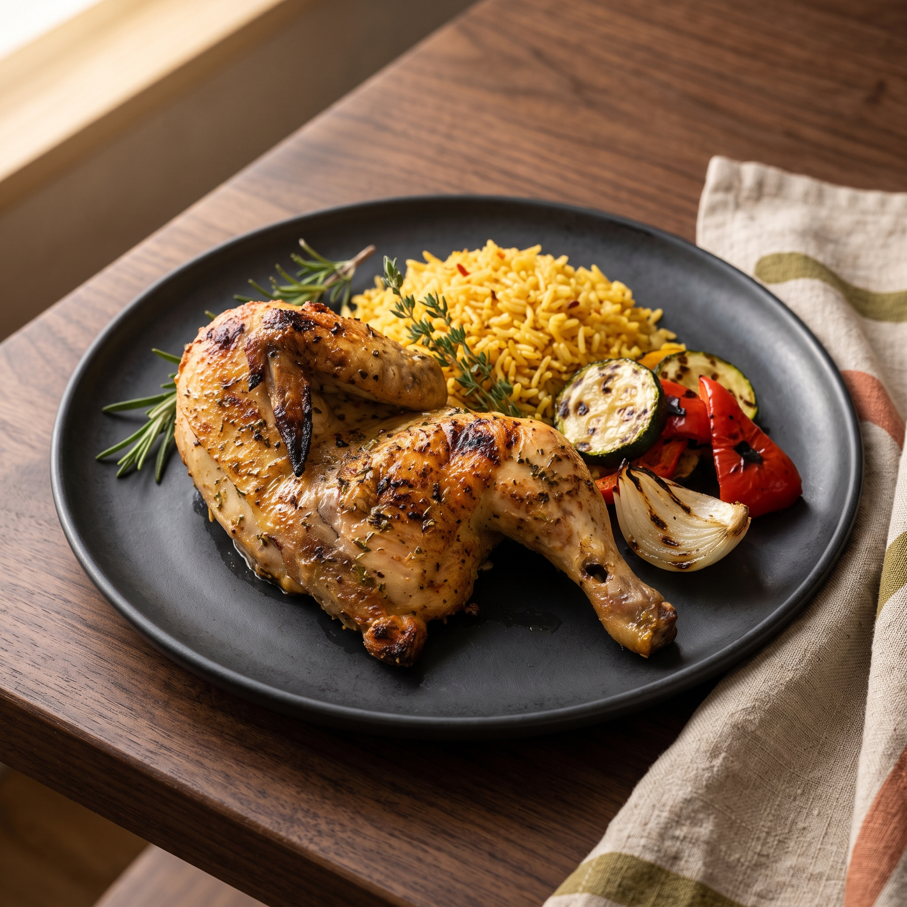

# LOQMA | لُقمة

> **مطعم عربي معاصر — تجربة طعام رقمية متكاملة**
> 
> موقع Frontend تفاعلي يعرض قائمة طعام منظمة، يتيح استكشاف الأطباق، إضافتها إلى السلة، وإتمام تجربة طلب كاملة — بواجهة عربية أصيلة، وتصميم عصري، وتجربة مستخدم سلسة على جميع الأجهزة.



---

## 📖 نظرة عامة

**LOQMA** هو مشروع Frontend متكامل لمطعم عربي معاصر. يهدف إلى تقديم تجربة رقمية تُترجم هوية المطعم البصرية إلى واجهة استخدام حقيقية — من استكشاف القائمة، إلى إتمام الطلب.

المشروع ليس Landing Page، بل **تطبيق ويب متعدد الصفحات** (SPA) يحتوي على:
- قائمة طعام تفاعلية مع بحث وتصفية.
- سلة تسوق محفوظة محليًا.
- نظام مفضلة.
- تجربة دفع تجريبية كاملة.
- دعم كامل للعربية (RTL) والإنجليزية (LTR).
- وضع فاتح وداكن.

> **ملاحظة:** هذا المشروع **Frontend فقط** — لا يوجد Backend، ولا تُرسل أي طلبات إلى مطعم حقيقي. تجربة الطلب تجريبية بالكامل لأغراض العرض.

---

## ✨ الميزات الرئيسية

### 🍽️ استكشاف القائمة
- **26 منتجًا** موزعة على 4 تصنيفات (مقبلات، أطباق رئيسية، حلويات، مشروبات).
- **بحث فوري** بالاسم والوصف بالعربية والإنجليزية.
- **تصفية حسب التصنيف** مع مزامنة URL (`/menu?category=desserts`) — يمكن مشاركة الرابط مباشرة.
- **إبراز نتائج البحث** بـ `<mark>` لتوضيح الكلمة المطابقة.
- **عدّاد نتائج** ديناميكي ("عرض 6 من 26 طبق").

### 📄 صفحة تفاصيل المنتج
- صورة كبيرة، اسم، وصف كامل، سعر.
- **خيارات المنتج** (حجم، إضافات) تُغيّر السعر تلقائيًا.
- اختيار الكمية مع تحقق من الحد الأدنى.
- **Cross-sell** ("أضف معه") — اقتراح أطباق مكملة.
- **منتجات مشابهة** من نفس التصنيف.
- **Sticky Add to Cart** على الجوال.

### 🛒 سلة التسوق
- **Drawer جانبي** يفتح فورًا عند الإضافة — بدون مغادرة الصفحة.
- تعديل الكميات، حذف الأصناف، إفراغ السلة.
- **حساب الإجمالي** من السعر × الكمية.
- **حفظ تلقائي في `localStorage`** — السلة تبقى بعد تحديث الصفحة.
- استعادة آمنة: تجاهل العناصر غير الصالحة أو غير المتوفرة.

### ❤️ المفضلة
- زر القلب على كل بطاقة منتج.
- صفحة `/wishlist` مخصصة.
- محفوظة في `localStorage`.

### 💳 تجربة الدفع (Demo)
- التحقق من الاسم ورقم الهاتف.
- **كود خصم `LOQMA10`** (خصم 10%).
- **رسوم توصيل ₪ 15** (مجانًا فوق ₪ 100).
- رقم مرجعي تجريبي.
- **صفحة تأكيد** تعرض ملخص الطلب الكامل.
- **الطلب يبقى بعد تحديث الصفحة** (بفضل `sessionStorage`).

### 🌐 دعم اللغات والاتجاهات
- **العربية (RTL)** افتراضيًا — مع خطوط Alexandria و IBM Plex Sans Arabic.
- **الإنجليزية (LTR)** — مع خط Inter.
- تبديل فوري دون فقدان حالة السلة أو المفضلة.
- **الوضع الفاتح والداكن** مع حفظ التفضيل.

### 📱 تصميم متجاوب
- من **360px** (هواتف صغيرة) إلى **1440px+** (شاشات كبيرة).
- شبكات متجاوبة (1-4 أعمدة حسب الشاشة).
- Navbar مع Drawer للجوال.
- لا يوجد تمرير أفقي.

### ♿ Accessibility
- تنقل كامل بلوحة المفاتيح.
- تسميات واضحة لكل حقل (`<label>`، `aria-label`).
- تباين ألوان يتوافق مع WCAG AA.
- `focus-visible` على كل العناصر التفاعلية.
- دعم `prefers-reduced-motion`.

### 🎬 الأنيميشن
- **Framer Motion** في كل الصفحات:
  - Scroll Reveal (عناصر تظهر عند التمرير).
  - Staggered Grid (بطاقات تظهر واحدة تلو الأخرى).
  - Hover Micro-interactions (رفع البطاقة، تكبير الصورة).
  - Page Transitions (انتقال ناعم بين الصفحات).
  - Ken Burns + Parallax في Hero.

---

## 🛠️ التقنيات المستخدمة

| الطبقة | التقنية | السبب |
|---|---|---|
| **Framework** | React 19 | أحدث إصدار، Concurrent Features |
| **Build Tool** | Vite 8 | سرعة تطوير فائقة، HMR فوري |
| **UI Library** | MUI v9 + Emotion | نظام تصميم متكامل، RTL support |
| **Routing** | React Router v7 | SPA routing مع URL sync |
| **State Management** | Context API + useReducer | كافٍ لحجم المشروع، لا حاجة لـ Redux |
| **Persistence** | localStorage | حفظ السلة والمفضلة والتفضيلات |
| **Animation** | Framer Motion | أنيميشن احترافي، أداء عالٍ |
| **SEO** | react-helmet-async | Meta tags ديناميكية، JSON-LD |
| **Fonts** | Alexandria, IBM Plex Sans Arabic, Inter | خطوط عربية ولاتينية احترافية |
| **Deployment** | Vercel | نشر فوري، SPA rewrites |

---

## 🚀 التشغيل المحلي

### المتطلبات
- Node.js 20.19+ أو 22.12+ (متطلب Vite 8)
- npm 10+

### التثبيت

```bash
# استنساخ المشروع
git clone https://github.com/areejoukal/loqma.git
cd loqma

# تثبيت الاعتماديات
npm install

# تشغيل خادم التطوير
npm run dev
